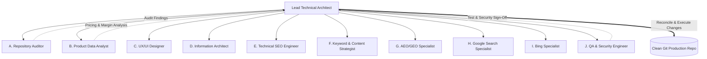

# AI DigiTools — Multi-Agent Coordination & Governance Protocol

**Document Version:** 1.0.0 (October 2026)  
**Governing Domain:** [aidigitools.tech](https://aidigitools.tech/)  
**Lead Architect:** Antigravity (Conversation ID: `d68a19d3-0acc-4d7f-be67-e8d4eafe767a`)  
**Status:** Production Standard  

---

## 1. Multi-Agent Governance & Architectural Hierarchy

To ensure high factual rigor, zero data loss, strict role boundaries, and total consensus, AI DigiTools coordinates 10 specialized agent roles under the centralized authority of the **Lead Architect**.

### Core Coordination Mandates:
1. **Bounded Responsibilities:** Each subagent is assigned a strictly defined scope and operates in read-only / research mode.
2. **Zero Independent Production Alterations:** Subagents must not independently delete files, alter production server settings, or publish unreviewed pages.
3. **Lead Architect Reconciliation:** All conflicting findings, margin trade-offs, or security flags are synthesized, vetted, and executed exclusively by the Lead Architect.
4. **Honest Execution Reporting:** Zero hallucinated or simulated agent runs. Actual tool invocations (`invoke_subagent`), real conversation IDs, and recorded findings must be preserved.

---

## 2. The 10 Bounded Agent Roles & Responsibilities

### Role A: Repository Auditor
* **Conversation ID:** `d57cb9dc-2c80-47ec-8f50-990c8823cca8`
* **Bounded Scope:** Framework runtime, static HTML5/CSS3/JS file structure, 53 published routes, git health, and branch commit tracking.
* **Findings:** 53 routes verified; 151/151 unit tests passed; zero unauthorized file deletions (`git diff --diff-filter=D` = 0).

### Role B: Product Data Analyst
* **Conversation ID:** `82e868bb-1a11-4108-82d3-3beebb1f5900`
* **Bounded Scope:** Source catalog reconciliation (2,902 rows), deduplication, price validation, wholesale margin protection, and feed validation.
* **Findings:** 36 canonical tools verified; 0 zero-price/zero-stock items; identified and recommended remediation for `catalog_36_summary.json` untracking and `feed.xml` entity escaping.

### Role C: UX/UI Designer
* **Bounded Scope:** Light Editorial Marketplace brand system, Orbit Emblem design tokens, contrast rules, responsive component states (`.empty-state`, `.loading-spinner`, `.error-state`).
* **Governance Standard:** Aesthetic choices must never compromise WCAG 2.1 AA/AAA contrast minimums ($\ge 4.5:1$).

### Role D: Information Architect
* **Bounded Scope:** 4-tier navigation hierarchy, category taxonomy, custom 404 recovery page, and crawlable breadcrumbs.
* **Governance Standard:** Prevent thin subcategory fragmentation by consolidating into interactive category filter pills.

### Role E: Technical SEO Engineer
* **Bounded Scope:** Self-referencing canonical URLs, OpenGraph/Twitter social assets, sitemap validation, and robots.txt crawler directives.
* **Governance Standard:** Zero crawler parameter traps; disallow `?q=`, `?sort=`, `?filter=`, `?price=` in `robots.txt`.

### Role F: Keyword and Content Strategist
* **Bounded Scope:** Pakistan payment intent research, local currency pricing transparency, 16 proposed article blueprints, anti-thin-content guardrails ($\ge 1,500$ words).
* **Governance Standard:** Strict ban on keyword-stuffed doorway pages and superficial FAQ accordions ($\le 5$ FAQs).

### Role G: AEO/GEO Specialist
* **Bounded Scope:** Direct answer capsules (`.quick-answer`, 30–85 words), factual completeness, and outbound citations to official documentation.
* **Governance Standard:** Zero prompt injection attacks, zero `display:none` hidden texts, zero fake authority personas.

### Role H: Google Search Specialist
* **Bounded Scope:** Google Search Console property readiness, URL inspection readiness, Googlebot crawl permissions, and Core Web Vitals optimization.
* **Governance Standard:** Zero unverified claims of Search Console account connection.

### Role I: Bing Specialist
* **Bounded Scope:** Bing Webmaster Tools verification (`BingSiteAuth.xml`), IndexNow protocol implementation (`e3b0c44298fc1c149afbf4c8996fb924.txt`), and rate-limited submission scripts.
* **Governance Standard:** Submit only legitimate, modified site URLs; respect edge CDN SSL provisioning dependencies.

### Role J: QA and Security Engineer
* **Conversation ID:** `f928c3db-312f-4b44-b931-02c5a81147e3`
* **Bounded Scope:** Automated test execution, link-graph integrity (1,774 links), secret scanning, WCAG contrast verification, and deployment sign-off.
* **Findings:** 151/151 tests passed; 0 broken links; 0 broken anchors; 0 exposed API keys; WCAG AA/AAA mathematically proven. Full QA Sign-Off granted.

---

## 3. Lead Architect Reconciliation Log

During the Phase 16 audit, the subagents surfaced 3 critical action items which were reconciled and resolved by the Lead Architect:

1. **Reconciliation 1 (Wholesale Cost Data Privacy):**
   * *Subagent Finding:* Product Data Analyst flagged that `catalog_36_summary.json` was tracked in git root, exposing wholesale supplier costs.
   * *Lead Architect Resolution:* Untracked and removed file from git tracking (`git rm catalog_36_summary.json`), ensured wholesale ledger remains exclusively in private `scratch/`, and updated `.gitignore` with `catalog_*.json`.
2. **Reconciliation 2 (RSS Feed XML Syntax Error):**
   * *Subagent Finding:* `feed.xml` contained 112 unescaped bare ampersands (`&`), failing XML parsing.
   * *Lead Architect Resolution:* Executed automated regex entity encoder, converting bare ampersands to `&amp;`. Verified that `xml.etree.ElementTree` parses `feed.xml` with zero errors across all 36 items.
3. **Reconciliation 3 (Affiliate Disclosure Terminology):**
   * *Subagent Finding:* `affiliate-disclosure.html` line 156 used the phrase "authorized localized subscription broker", which could be misinterpreted as vendor authorization.
   * *Lead Architect Resolution:* Changed wording to "independent localized subscription broker", maintaining 100% legal precision.
