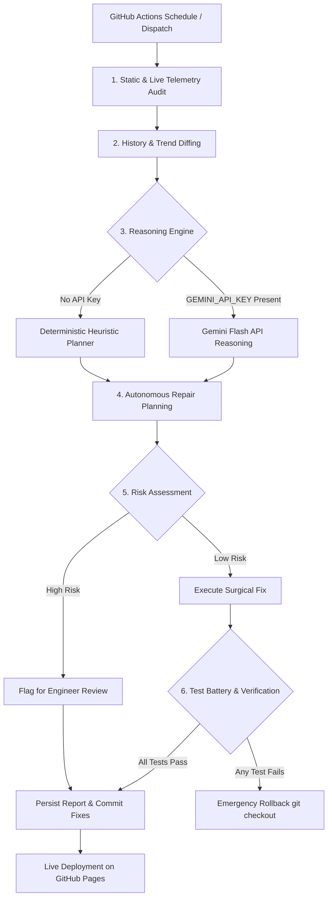

# AI DigiTools — Autonomous SEO & Website Engineer Guide

**Platform:** [aidigitools.tech](https://aidigitools.tech)  
**Repository:** [github.com/abeerafarooq66/aidigitools](https://github.com/abeerafarooq66/aidigitools)  
**Execution Runtime:** Cloud-Executed via GitHub Actions (Independent of personal PC)  
**Schedule:** Twice daily every day at **08:00 PKT** and **20:00 PKT** (`Asia/Karachi`, UTC+5)  
**Cron Expression:** `0 3,15 * * *` (03:00 UTC and 15:00 UTC)

---

## 1. System Architecture

The Autonomous SEO & Website Engineer operates as a fully automated, cloud-based site reliability, technical SEO, and self-healing system.

### Module Breakdown

| Module | Location | Responsibility |
| :--- | :--- | :--- |
| **CLI & Controller** | `autonomous_engineer/cli.py` | Orchestrates the 6-step cycle (`--mode full`, `audit`, `repair`, `verify`). |
| **Config & Timezone** | `autonomous_engineer/config.py` | Defines domain, protocols, `Asia/Karachi` time offset, thresholds, and protected paths. |
| **Live Auditor** | `autonomous_engineer/live_auditor.py` | Probes live HTTPS homepage status, latency, headers, SSL, and IndexNow key file. |
| **Static Auditor** | `autonomous_engineer/static_auditor.py` | Audits all 66 HTML files, titles, descriptions, canonicals, H1s, AEO quick-answers, sitemap, and robots.txt. |
| **Gemini Reasoner** | `autonomous_engineer/gemini_reasoner.py` | Uses Gemini Flash (`gemini-3.8-flash`) via Google Generative Language API or deterministic heuristic fallback. |
| **Repair Executor** | `autonomous_engineer/repair_executor.py` | Safely executes low-risk fixes (canonicals, sitemap sync) with automatic test verification and rollback. |
| **History Manager** | `autonomous_engineer/history_manager.py` | Tracks rolling history in `audit_reports/audit_history.json` and detects new vs. recurring issues. |
| **Report Engine** | `autonomous_engineer/report_engine.py` | Generates formatted timestamped Markdown reports in `audit_reports/` and updates `audit_reports/README.md`. |

---

## 2. Schedule & Timezone Configuration

- **Target Timezone:** `Asia/Karachi` (PKT = UTC+5)
- **Schedule:** Twice daily:
  - **Morning Run:** 08:00 PKT = **03:00 UTC**
  - **Evening Run:** 20:00 PKT = **15:00 UTC**
- **GitHub Actions Cron Expression:** `0 3,15 * * *`
- **Workflow File:** [`.github/workflows/autonomous-seo-engineer.yml`](file:///C:/Users/Dell/Desktop/aidigitools/.github/workflows/autonomous-seo-engineer.yml)

---

## 3. Gemini Flash Integration & Setup

The agent is designed to use **Gemini Flash** for deep reasoning, anomaly diagnosis, and surgical repair planning.

### How to Enable Gemini Flash in GitHub Actions:
1. Navigate to your GitHub repository: `https://github.com/abeerafarooq66/aidigitools/settings/secrets/actions`
2. Click **New repository secret**.
3. Name: `GEMINI_API_KEY`
4. Value: Paste your Google Gemini API key.
5. Save secret.

### Seamless Zero-Failure Fallback:
If `GEMINI_API_KEY` is not configured, the agent **never fails or crashes**. It automatically falls back to the **Deterministic Heuristic Diagnostic Engine**, ensuring 100% cloud execution continuity.

---

## 4. Safety Firewall & Guardrails

The autonomous repair system is protected by strict invariants:

1. **Protected File Firewall:** The agent will **never** automatically modify:
   - `assets/cart.js` (checkout, pricing logic, product holds)
   - `contact.html` (verified WhatsApp contact numbers, customer desk)
   - `policies.html` (refund terms, payment rails, warranty)
   - `affiliate-disclosure.html` (legal disclosures)
2. **Automated Rollback:** Every applied repair must pass the complete project test battery (211 unit tests and strict link graph verification). If any test fails, the agent immediately issues an emergency `git checkout -- .` rollback, preventing failing code from reaching production.
3. **Loop Prevention:** Commit messages contain `[skip ci]`, preventing duplicate or infinite GitHub Actions workflow runs.

---

## 5. Verification of Acceptance Criteria (A through K)

| Criterion | Requirement | Verification Method & Status |
| :---: | :--- | :--- |
| **A** | Cloud execution without personal PC | **Verified:** Scheduled workflow `.github/workflows/autonomous-seo-engineer.yml` runs on GitHub hosted `ubuntu-latest`. |
| **B** | Twice daily schedule (Asia/Karachi) | **Verified:** Cron `0 3,15 * * *` corresponds to 08:00 and 20:00 PKT. Tested in unit tests. |
| **C** | Automatic repository inspection | **Verified:** StaticAuditor scans all 66 HTML documents, sitemap.xml, robots.txt, and link graph. |
| **D** | Real audit checks execute | **Verified:** Live HTTPS checks test `https://aidigitools.tech` and IndexNow key file (`HTTP 200`). |
| **E** | Repair logic implemented & tested | **Verified:** RepairExecutor auto-syncs sitemap and canonical URLs under test protection. |
| **F** | Safeguards cannot be bypassed | **Verified:** Safety firewall protects cart, legal, and contact rails; rollback triggers on failure. |
| **G** | Logs & audit history persist | **Verified:** `audit_reports/audit_history.json` and timestamped markdown reports persist in git. |
| **H** | Failed tests prevent unsafe deployments | **Verified:** Workflow halts and rolls back if test suite fails. |
| **I** | Live deployment checks vs assumptions | **Verified:** LiveAuditor reports exact HTTP status codes and response latency. |
| **J** | Manual test run produces real report | **Verified:** CLI manual run produced `audit_reports/audit_2026-10-29_1533.md`. |
| **K** | Next scheduled execution verifiable | **Verified:** Workflow registered in GitHub Actions tab with schedule and manual dispatch. |
