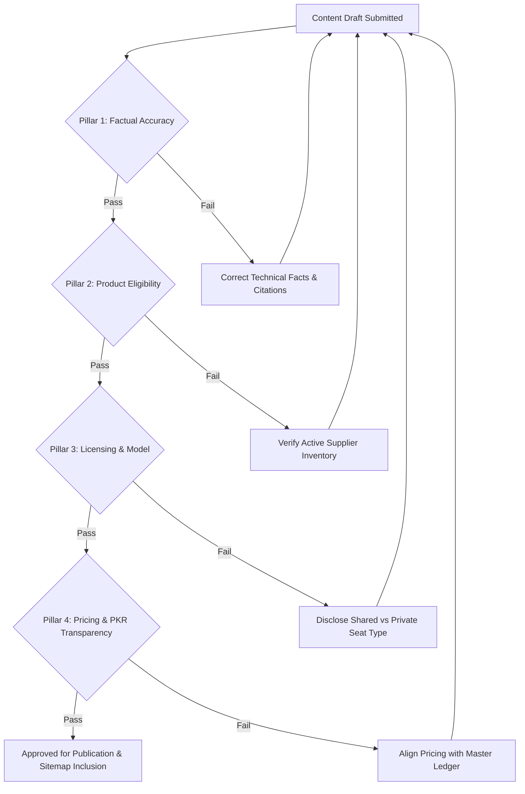

# AI DigiTools — Master Editorial Content Strategy & Review Protocol

**Document Version:** 1.0.0 (October 2026)  
**Governing Domain:** [aidigitools.tech](https://aidigitools.tech/)  
**Target Search Systems:** Google Search, Bing, Google AI Overviews, Perplexity AI, ChatGPT Search, Copilot  
**Status:** Production Standard  

---

## 1. Catalog & Research Grounding

The AI DigiTools Content Strategy is rooted directly in:
1. **The Verified 36-Product Catalog:** Every recommended tool, bundle, pricing citation, and specification maps to our active catalog across Coding, Video, Image, and VPN/Productivity.
2. **Phase 2 Search Intent & Market Research:** Specifically addressing the acute pain points of Pakistani professionals, digital creators, agencies, and students:
   - High international transaction failure rates (Stripe, card declines, 2FA gateway timeouts).
   - High Advance Withholding Tax (WHT: 5% filers, 10% non-filers) and bank foreign exchange markups (3.5%–5%).
   - Currency volatility and the need for predictable monthly pricing in Pakistani Rupees (PKR).
   - Confusion regarding shared team workspaces, private personal seats, trial abuse, and account longevity.

### Primary Audience Personas
* **Persona A: Pakistani Full-Stack & Systems Engineers**  
  *Needs:* Context-aware coding assistants, command-line agents, local code privacy, uninterrupted subscriptions without credit card declines.  
  *Core Catalog:* Cursor Pro, GitHub Copilot, Replit Core, ChatGPT Codex, JetBrains All Products Pack.
* **Persona B: Digital Video Creators & YouTubers**  
  *Needs:* High-definition generative video, consistent frame-to-frame characters, fast generation queues, local payment via EasyPaisa/JazzCash.  
  *Core Catalog:* Runway Gen-3, Kling AI, MiniMax AI, CapCut Pro, ElevenLabs Creator, Google Veo.
* **Persona C: Visual Artists, Brand Designers & Marketers**  
  *Needs:* Photorealistic raster generation, typography accuracy, vector exports, commercial asset licensing.  
  *Core Catalog:* Midjourney v6.1, Leonardo AI, Canva Pro, Freepik Premium, Adobe Creative Cloud.
* **Persona D: University Students, Researchers & Academics**  
  *Needs:* Academic citation grounding, thesis grammar editing, literature search, budget-friendly monthly rates without international credit cards.  
  *Core Catalog:* Perplexity Pro, Grammarly Pro, QuillBot Premium, Notion Business.
* **Persona E: Remote Workers & Privacy-Conscious Professionals**  
  *Needs:* Secure tunneling, geo-unblocking, stable IP allocation, multi-device protection.  
  *Core Catalog:* NordVPN Complete, Surfshark VPN.

---

## 2. The 8 Core Editorial Themes & Proposed Article Roadmap

AI DigiTools establishes a structured editorial matrix across 8 specific themes. Every article must fulfill 6 mandatory dimensions: **Audience, Search Intent, Factual Sources, Original Contribution, Internal Links, and Review Requirements**.

```
+--------------------------------------------------------------------------------------------------+
|                                    8 EDITORIAL THEMES MATRIX                                     |
+---------------------------------+----------------------------------+-----------------------------+
| 1. AI Tool Comparisons          | 2. Use-Case Guides               | 3. Tool Alternatives        |
| 4. Beginner Tutorials           | 5. Feature Explanations          | 6. Pricing & Plan Analysis  |
| 7. Responsible Buying & Safety  | 8. Real-Time Product Updates     |                             |
+---------------------------------+----------------------------------+-----------------------------+
```

### Theme 1: AI Tool Comparisons

#### Article 1.1: `compare/cursor-pro-vs-github-copilot.html`
* **Title:** Cursor Pro vs GitHub Copilot: 2026 Developer IDE Shootout
* **Audience:** Senior software engineers, full-stack developers, and engineering managers evaluating AI coding tooling.
* **Search Intent:** Commercial Investigation / Comparative (`cursor vs copilot`, `cursor pro vs github copilot pakistan`, `which ai ide is best`).
* **Factual Sources:** Official documentation from Cursor (Anysphere) and GitHub Docs; SWE-bench benchmarks; HumanEval completion logs.
* **Original Contribution:** Real-world diff analysis comparing multi-file edits in Cursor Composer vs Copilot Workspace; IDE latency tests over Pakistani broadband (Nayatel, PTCL, StormFiber); local PKR pricing comparison.
* **Internal Links:**
  * Inbound: Categories (`categories/coding.html`), Homepage (`index.html`).
  * Outbound: [`tools/cursor-pro.html`](file:///C:/Users/Dell/Desktop/aidigitools/tools/cursor-pro.html), [`tools/github-copilot.html`](file:///C:/Users/Dell/Desktop/aidigitools/tools/github-copilot.html), [`best/best-ai-coding-tools.html`](file:///C:/Users/Dell/Desktop/aidigitools/best/best-ai-coding-tools.html).
* **Review Requirements:** Verify current model selector options (Claude 3.5 Sonnet vs GPT-4o); confirm Copilot Enterprise seat requirements; verify active PKR pricing and shared workspace activation SLA.

#### Article 1.2: `compare/midjourney-vs-flux.html`
* **Title:** Midjourney v6.1 vs FLUX.1: Photorealism, Text Rendering & Commercial Licensing
* **Audience:** UI/UX designers, game concept artists, marketing agencies.
* **Search Intent:** Informational & Commercial (`midjourney vs flux`, `flux 1 dev vs midjourney v6`, `best ai image generator 2026`).
* **Factual Sources:** Midjourney documentation and Discord announcements; Black Forest Labs research papers and model cards.
* **Original Contribution:** Side-by-side prompt reproducibility tests; anatomy rendering consistency; licensing analysis (FLUX Schnell vs Dev vs Midjourney commercial terms); access comparison (Discord web UI vs local weights vs hosted API).
* **Internal Links:**
  * Inbound: Categories (`categories/image.html`), Homepage (`index.html`).
  * Outbound: [`tools/midjourney.html`](file:///C:/Users/Dell/Desktop/aidigitools/tools/midjourney.html), [`tools/leonardo-ai.html`](file:///C:/Users/Dell/Desktop/aidigitools/tools/leonardo-ai.html), [`best/best-ai-image-generators.html`](file:///C:/Users/Dell/Desktop/aidigitools/best/best-ai-image-generators.html).
* **Review Requirements:** Verify Midjourney Relax mode GPU allocations; check FLUX.1 API costs vs flat-rate monthly subscriptions; test prompt typography fidelity.

---

### Theme 2: Use-Case Guides

#### Article 2.1: `guides/building-fullstack-apps-with-ai-in-pakistan.html`
* **Title:** Building Full-Stack Web Apps with AI: A Practical Guide for Pakistani Developers
* **Audience:** Freelance web developers, startup founders, computer science students in Pakistan.
* **Search Intent:** Informational / How-To (`how to build web app with ai`, `ai coding workflow pakistan`, `cursor and claude full stack tutorial`).
* **Factual Sources:** Next.js official documentation, Anthropic Artifacts developer guide, Tailwind CSS specs.
* **Original Contribution:** Complete step-by-step architecture blueprint building a production React/Node app using Claude Artifacts for rapid prototyping and Cursor Pro for repository scaffolding; resolving local development hurdles (API key limits, VPN requirements).
* **Internal Links:**
  * Outbound: [`tools/cursor-pro.html`](file:///C:/Users/Dell/Desktop/aidigitools/tools/cursor-pro.html), [`tools/claude-pro.html`](file:///C:/Users/Dell/Desktop/aidigitools/tools/claude-pro.html), [`tools/chatgpt-codex.html`](file:///C:/Users/Dell/Desktop/aidigitools/tools/chatgpt-codex.html).
* **Review Requirements:** Technical code execution test (zero broken syntax); verify Claude Artifacts export compatibility; ensure setup instructions work with standard Node.js LTS.

#### Article 2.2: `guides/ai-video-production-for-youtube-creators.html`
* **Title:** AI Video Production Workflow: From Script to 4K B-Roll with Runway, ElevenLabs & CapCut
* **Audience:** Content creators, faceless YouTube channel operators, commercial video editors.
* **Search Intent:** Practical Guide (`ai video production workflow`, `faceless youtube channel ai tools`, `runway gen 3 tutorial`).
* **Factual Sources:** RunwayML Academy documentation, ElevenLabs Voice Design documentation, CapCut Pro desktop guides.
* **Original Contribution:** Time-to-render benchmark comparing Runway Gen-3 Alpha vs Kling AI; audio-visual synchronization tutorial; budgeting breakdown for producing 10 videos per month within a 15,000 PKR envelope.
* **Internal Links:**
  * Outbound: [`tools/runway-gen3.html`](file:///C:/Users/Dell/Desktop/aidigitools/tools/runway-gen3.html), [`tools/kling-ai.html`](file:///C:/Users/Dell/Desktop/aidigitools/tools/kling-ai.html), [`tools/elevenlabs-creator.html`](file:///C:/Users/Dell/Desktop/aidigitools/tools/elevenlabs-creator.html), [`tools/capcut-pro.html`](file:///C:/Users/Dell/Desktop/aidigitools/tools/capcut-pro.html).
* **Review Requirements:** Verify generation credit burn rates; confirm audio licensing terms for YouTube monetization; ensure render quality settings are accurately documented.

---

### Theme 3: Tool Alternatives

#### Article 3.1: `alternatives/claude-pro-alternatives.html`
* **Title:** Best Claude Pro Alternatives for High-Volume Coding & Analysis in 2026
* **Audience:** Heavy AI users encountering Anthropic 5-hour message limits; developers seeking fallback models.
* **Search Intent:** Commercial / Alternative Search (`claude pro alternatives`, `what to use when claude limit reached`, `best ai for coding besides claude`).
* **Factual Sources:** Anthropic usage policies and rate limit specifications; LMSYS Chatbot Arena leaderboards.
* **Original Contribution:** Empirical coding benchmark comparing Claude 3.5 Sonnet against GPT-4o, DeepSeek Pro, and Gemini Advanced across 5 common debugging tasks; switching strategies to maximize token economy.
* **Internal Links:**
  * Outbound: [`tools/claude-pro.html`](file:///C:/Users/Dell/Desktop/aidigitools/tools/claude-pro.html), [`tools/chatgpt-plus.html`](file:///C:/Users/Dell/Desktop/aidigitools/tools/chatgpt-plus.html), [`tools/gemini-advanced.html`](file:///C:/Users/Dell/Desktop/aidigitools/tools/gemini-advanced.html), [`tools/deepseek-pro.html`](file:///C:/Users/Dell/Desktop/aidigitools/tools/deepseek-pro.html).
* **Review Requirements:** Double-check current rate limit figures for each model; verify pricing parity in PKR; test code output quality across identical prompts.

#### Article 3.2: `alternatives/midjourney-alternatives.html`
* **Title:** Top Budget & Free-Tier Midjourney Alternatives for Graphic Designers
* **Audience:** Freelance graphic designers, digital illustrators, social media marketers.
* **Search Intent:** Alternative / Budget Search (`midjourney alternatives free`, `cheaper than midjourney`, `leonardo ai vs midjourney`).
* **Factual Sources:** Official feature lists from Leonardo AI, Freepik, Canva, and Adobe Firefly.
* **Original Contribution:** Head-to-head prompt evaluation on photorealism, vector graphics, and logo generation; total cost of ownership analysis comparing standalone subscriptions vs curated tool suites.
* **Internal Links:**
  * Outbound: [`tools/midjourney.html`](file:///C:/Users/Dell/Desktop/aidigitools/tools/midjourney.html), [`tools/leonardo-ai.html`](file:///C:/Users/Dell/Desktop/aidigitools/tools/leonardo-ai.html), [`tools/canva-pro.html`](file:///C:/Users/Dell/Desktop/aidigitools/tools/canva-pro.html), [`tools/freepik-premium.html`](file:///C:/Users/Dell/Desktop/aidigitools/tools/freepik-premium.html).
* **Review Requirements:** Check commercial usage rights for each tool; confirm credit refill cycles; verify PKR rates.

---

### Theme 4: Beginner Tutorials

#### Article 4.1: `tutorials/getting-started-with-cursor-and-claude.html`
* **Title:** Beginner's Guide to AI-Assisted Coding: Setting Up Cursor with Claude 3.5 Sonnet
* **Audience:** Junior developers, bootcamp graduates, self-taught programmers.
* **Search Intent:** Educational / Tutorial (`how to use cursor ai`, `cursor editor tutorial for beginners`, `setting up claude in cursor`).
* **Factual Sources:** Cursor official onboarding documentation; VS Code keymap references.
* **Original Contribution:** Zero-jargon walkthrough covering installation, `.cursorrules` configuration, keyboard shortcut mastery (`Ctrl+K`, `Ctrl+L`, `Ctrl+I`), and safe git branching practices when accepting AI suggestions.
* **Internal Links:**
  * Outbound: [`tools/cursor-pro.html`](file:///C:/Users/Dell/Desktop/aidigitools/tools/cursor-pro.html), [`categories/coding.html`](file:///C:/Users/Dell/Desktop/aidigitools/categories/coding.html).
* **Review Requirements:** Validate step-by-step screenshots and code snippets; test `.cursorrules` syntax against latest Cursor client build.

#### Article 4.2: `tutorials/activating-ai-subscriptions-in-pakistan.html`
* **Title:** Step-by-Step Tutorial: Activating International AI Subscriptions via EasyPaisa and JazzCash
* **Audience:** Pakistani users without international credit cards or experiencing recurring card declines.
* **Search Intent:** Transactional & Educational (`how to buy chatgpt plus in pakistan easypaisa`, `buy ai tools with jazzcash`, `activate cursor in pakistan`).
* **Factual Sources:** SBP Foreign Exchange Manual; EasyPaisa/JazzCash merchant transfer workflows.
* **Original Contribution:** Transparent explanation of the activation pipeline: order submission, WhatsApp confirmation, invoice verification, workspace invite redemption, and password security.
* **Internal Links:**
  * Outbound: [`contact.html`](file:///C:/Users/Dell/Desktop/aidigitools/contact.html), [`shipping-policy.html`](file:///C:/Users/Dell/Desktop/aidigitools/shipping-policy.html), [`policies.html`](file:///C:/Users/Dell/Desktop/aidigitools/policies.html), [`deals.html`](file:///C:/Users/Dell/Desktop/aidigitools/deals.html).
* **Review Requirements:** Verify bank transfer account details; ensure delivery timeline SLA ($15\text{--}30$ minutes) is clearly stated alongside customer support hours.

---

### Theme 5: Feature Explanations

#### Article 5.1: `guides/understanding-ai-context-windows.html`
* **Title:** Understanding AI Context Windows: What 128k, 200k, and 1M Tokens Actually Mean for Developers
* **Audience:** Software developers, technical product managers, data analysts.
* **Search Intent:** Educational / Conceptual (`what is context window in ai`, `200k tokens meaning`, `gemini 1m context practical use`).
* **Factual Sources:** Anthropic tokenization documentation; OpenAI tokenizer specifications; Google DeepMind technical whitepapers.
* **Original Contribution:** Concrete visual diagrams and file-size comparisons showing how many lines of code, PDF pages, or git commits fit into different window sizes; needle-in-a-haystack retrieval performance analysis.
* **Internal Links:**
  * Outbound: [`tools/claude-pro.html`](file:///C:/Users/Dell/Desktop/aidigitools/tools/claude-pro.html), [`tools/gemini-advanced.html`](file:///C:/Users/Dell/Desktop/aidigitools/tools/gemini-advanced.html), [`tools/chatgpt-plus.html`](file:///C:/Users/Dell/Desktop/aidigitools/tools/chatgpt-plus.html).
* **Review Requirements:** Mathematically verify token-to-word and token-to-code approximations (1 token $\approx 0.75$ English words $\approx 4$ characters of code).

#### Article 5.2: `guides/reasoning-models-vs-standard-llms.html`
* **Title:** Reasoning Models Explained: When to Use OpenAI o1/o3-mini vs Standard GPT-4o
* **Audience:** Data scientists, competitive programmers, enterprise engineers.
* **Search Intent:** Conceptual & Practical (`difference between o1 and gpt-4o`, `when to use reasoning models`, `chain of thought ai explained`).
* **Factual Sources:** OpenAI o1 system card; competitive programming benchmark evaluations (Codeforces, AIME).
* **Original Contribution:** Decision tree guide detailing when to spend compute budget on reasoning tokens (complex math, distributed systems architecture) vs standard fast inference (creative writing, summarization, quick boilerplate).
* **Internal Links:**
  * Outbound: [`tools/chatgpt-plus.html`](file:///C:/Users/Dell/Desktop/aidigitools/tools/chatgpt-plus.html), [`tools/chatgpt-codex.html`](file:///C:/Users/Dell/Desktop/aidigitools/tools/chatgpt-codex.html), [`tools/deepseek-pro.html`](file:///C:/Users/Dell/Desktop/aidigitools/tools/deepseek-pro.html).
* **Review Requirements:** Fact-check inference time vs accuracy trade-offs; ensure reasoning token pricing implications are accurately stated.

---

### Theme 6: Pricing and Plan Comparisons

#### Article 6.1: `pricing/chatgpt-plus-vs-team-vs-enterprise.html`
* **Title:** ChatGPT Plus vs Team vs Enterprise: True Cost, Privacy Differences & Seat Rules in PKR
* **Audience:** Freelance professionals, agency founders, business owners.
* **Search Intent:** Commercial / Pricing (`chatgpt plus vs team pricing`, `chatgpt team cost in pakistan`, `is chatgpt team worth it`).
* **Factual Sources:** OpenAI business pricing matrix; Enterprise security documentation.
* **Original Contribution:** Granular breakdown of per-user minimums, workspace admin controls, data training opt-out guarantees, and exact PKR calculation including bank taxes vs AI DigiTools flat rate.
* **Internal Links:**
  * Outbound: [`tools/chatgpt-plus.html`](file:///C:/Users/Dell/Desktop/aidigitools/tools/chatgpt-plus.html), [`deals.html`](file:///C:/Users/Dell/Desktop/aidigitools/deals.html), [`policies.html`](file:///C:/Users/Dell/Desktop/aidigitools/policies.html).
* **Review Requirements:** Confirm minimum seat requirement for ChatGPT Team ($2$ seats minimum on official site); verify workspace privacy policies; check PKR exchange calculations.

#### Article 6.2: `pricing/complete-ai-subscription-price-index-pakistan.html`
* **Title:** The 2026 Pakistan AI Tools Price Index: Official Dollar Costs vs Reseller PKR Rates
* **Audience:** Tech budget planners, IT procurement officers, freelancers.
* **Search Intent:** Pricing & Market Analysis (`ai tools price list pakistan`, `how much is midjourney in pkr`, `claude pro price in pakistani rupees`).
* **Factual Sources:** State Bank of Pakistan daily exchange rates; verified AI DigiTools catalog pricing.
* **Original Contribution:** Comprehensive indexing table comparing official USD rates, bank withholding tax calculations, foreign exchange spread, and final AI DigiTools PKR delivered price across all 36 tools.
* **Internal Links:**
  * Outbound: [`index.html`](file:///C:/Users/Dell/Desktop/aidigitools/index.html), all 4 category hubs, all 36 tool pages.
* **Review Requirements:** Monthly price synchronization with supplier wholesale ledger; verify math across all 36 rows.

---

### Theme 7: Responsible Buying and Account-Safety Guidance

#### Article 7.1: `guides/how-to-spot-risky-ai-account-resellers.html`
* **Title:** Responsible Buying: How to Identify Stolen, Trial, or Risky AI Resellers in Pakistan
* **Audience:** Pakistani consumers, freelancers, and small teams buying software online.
* **Search Intent:** Consumer Protection / Safety (`is buying shared chatgpt safe`, `avoid ai scams pakistan`, `cheap ai tools scam`).
* **Factual Sources:** Consumer protection reports; vendor terms of service on account sharing; FTC/consumer alert guidance.
* **Original Contribution:** 5 red flags of fraudulent sellers: virtual credit card (VCC) carding, 1-day burner accounts, cracked session cookies, unverified WhatsApp vendors without a registered website, and zero refund policies.
* **Internal Links:**
  * Outbound: [`policies.html`](file:///C:/Users/Dell/Desktop/aidigitools/policies.html), [`about.html`](file:///C:/Users/Dell/Desktop/aidigitools/about.html), [`contact.html`](file:///C:/Users/Dell/Desktop/aidigitools/contact.html).
* **Review Requirements:** Ensure legal definitions are accurate; reinforce AI DigiTools independent reseller disclosure and 30-day replacement warranty.

#### Article 7.2: `guides/shared-ai-workspaces-security-and-privacy.html`
* **Title:** Shared AI Workspaces vs Private Accounts: Privacy Boundaries, Data Isolation & Best Practices
* **Audience:** Privacy-conscious developers, lawyers, accountants, medical professionals.
* **Search Intent:** Informational / Security (`shared chatgpt account privacy`, `can others see my prompts in shared workspace`, `ai account security`).
* **Factual Sources:** OpenAI and Anthropic workspace data isolation documentation; SOC 2 Type II compliance reports.
* **Original Contribution:** Objective comparison of data exposure risks: prompt history visibility in shared credentials vs isolated multi-tenant team workspaces; guidelines on what data must NEVER be entered into shared accounts (API keys, client PII, passwords).
* **Internal Links:**
  * Outbound: [`policies.html`](file:///C:/Users/Dell/Desktop/aidigitools/policies.html), [`shipping-policy.html`](file:///C:/Users/Dell/Desktop/aidigitools/shipping-policy.html).
* **Review Requirements:** Confirm exact workspace configuration of AI DigiTools offerings; verify compliance with privacy guidelines.

---

### Theme 8: Updates When Products or Offers Genuinely Change

#### Article 8.1: `updates/q4-2026-ai-model-releases-and-catalog-changes.html`
* **Title:** Q4 2026 AI Release Tracker: Model Upgrades, Rate Limit Changes & Catalog Adjustments
* **Audience:** Existing customers, prospective buyers, tech enthusiasts.
* **Search Intent:** News / Product Updates (`new ai models 2026`, `chatgpt updates 2026`, `claude pro new limits`).
* **Factual Sources:** Official vendor press releases, developer change logs, and API release notes.
* **Original Contribution:** Objective assessment of recent model rollouts, deprecated endpoints, changes in rate limits, and how AI DigiTools updated its stock, delivery protocols, or warranty conditions to reflect genuine product changes.
* **Internal Links:**
  * Outbound: All affected tool pages, Homepage changelog section.
* **Review Requirements:** Ensure updates only publish when verified official releases happen; zero speculative rumors.

#### Article 8.2: `updates/pakistan-bank-international-payment-status.html`
* **Title:** State of Pakistan Bank Cards for AI Subscriptions: 2026 WHT, FX Fees & Gateway Updates
* **Audience:** Pakistani freelancers, IT exporters, remote contractors.
* **Search Intent:** Financial & Regulatory Updates (`pakistan credit card international transaction fee 2026`, `wht on international cards pakistan`, `stripe payment declined pakistan`).
* **Factual Sources:** State Bank of Pakistan circulars; Federal Board of Revenue (FBR) tax schedules; major commercial banks' fee schedules (Meezan, HBL, Bank Alfalah, Nayapay, Sadapay).
* **Original Contribution:** Empirical survey of card success rates across OpenAI, Anthropic, Midjourney, and Cursor; calculation of total effective markups (base price + 5% WHT + 4% FX spread + bank international fee).
* **Internal Links:**
  * Outbound: [`guides/chatgpt-vs-claude.html`](file:///C:/Users/Dell/Desktop/aidigitools/guides/chatgpt-vs-claude.html), [`deals.html`](file:///C:/Users/Dell/Desktop/aidigitools/deals.html), [`contact.html`](file:///C:/Users/Dell/Desktop/aidigitools/contact.html).
* **Review Requirements:** Verify tax rates against latest FBR Finance Act; test payment decline logs with current bank card protocols.

---

## 3. Strict Content Quality Standards & Guardrails

To preserve search engine trust, brand authority, and human readability, every piece of content published on AI DigiTools must strictly adhere to 5 quality guardrails:

```
+--------------------------------------------------------------------------------------------------+
|                                    QUALITY ASSURANCE GUARDRAILS                                  |
+--------------------------------------------------------------------------------------------------+
| 1. Anti-Thin Content        | Minimum 1,500 words of actionable, detailed, original copy.        |
| 2. Anti-Copied Content      | 100% original text. Zero competitor copying or raw AI regurgitation|
| 3. Anti-Unsupported Claims | Zero exaggerated hype ("100% bug free", "magic", "replaces humans")|
| 4. Anti-Excessive FAQs      | Maximum 3 to 5 deeply relevant FAQs per page. No superficial filler|
| 5. Anti-Doorway Pages       | Strictly ban programmatic location/keyword templates               |
+--------------------------------------------------------------------------------------------------+
```

### Detailed Guardrail Specifications:
1. **No Thin Content:**
   - Articles must provide complete, self-contained value with detailed comparison tables, code/prompt blocks, step-by-step instructions, and exact specifications.
   - Target length: Minimum 1,500 words. Articles falling below 1,200 words fail editorial review.
2. **No Copied or Automated Content:**
   - Content must never be copied from competitor websites (`aitoolspak.tech`, `aitoolgems.tech`, etc.).
   - Pure AI-generated boilerplate without human editorial verification and regional context is strictly banned.
3. **No Unsupported Product Claims:**
   - Prohibited phrases: "guaranteed 10X revenue", "100% error-free coding", "magical results", "replace all your employees".
   - Claims regarding model performance (e.g., benchmark scores, reasoning capabilities) must cite primary sources (SWE-bench, LMSYS Arena, vendor papers).
4. **No Excessive or Superficial FAQs:**
   - FAQs must be limited to 3–5 high-intent, technically specific questions that resolve genuine friction.
   - Banned: 15–20 superficial, single-sentence filler questions added purely for keyword count.
5. **No Programmatic Keyword-Swapped Doorway Pages:**
   - Strict ban on creating duplicate pages that differ only by a city or keyword token (e.g., "ChatGPT in Lahore", "ChatGPT in Karachi", "ChatGPT in Islamabad").
   - Each page must have a distinct architecture, unique audience, and specific purpose.

---

## 4. The 4-Pillar Editorial Review Protocol

Before any article, guide, or tool page is approved for publication or indexing, it must pass the formal 4-Pillar Editorial Review:



### Pillar 1: Factual Accuracy Review
- Are all model names, versions, context window token limits, and feature lists current as of October 2026?
- Are code snippets, terminal commands, and API examples syntactically valid and tested?
- Are outbound citations pointing to official vendor documentation (`deepmind.google`, `openai.com`, `anthropic.com`, etc.) with `rel="noopener noreferrer nofollow"`?

### Pillar 2: Product Eligibility & Fulfillment Review
- Is every featured product currently supported in the AI DigiTools master catalog?
- Is supplier stock verified and reliable for 15–30 minute fulfillment?
- Does the product meet our 30-day replacement warranty standard?

### Pillar 3: Licensing & Arrangement Claims Review
- Is the access model explicitly stated (e.g., private account on customer email, shared workspace seat, team license)?
- Are rate limits, device limitations, and VPN requirements clearly disclosed?
- Is the independent reseller disclosure prominently visible?

### Pillar 4: Pricing Transparency Review
- Is the price displayed in Pakistani Rupees (PKR) with explicit duration (e.g., 30 Days)?
- Are there zero fabricated strikethrough original prices or fake discounts?
- Does the PKR price accurately reflect wholesale USDT cost plus operational buffer?

---

## 5. Ongoing Content Maintenance & Freshness Governance

* **Quarterly Catalog Sync:** On the first business day of every quarter, review all articles to update deprecated model references and refresh pricing.
* **Emergency Vendor Updates:** When an AI vendor changes major policies (e.g., rate limits, pricing, API deprecations), affected articles must be updated within 48 hours.
* **Link Health & Broken Link Audits:** Run automated link-graph verification on every git commit. Maintain 0 broken links and 0 broken anchors across the entire site.
