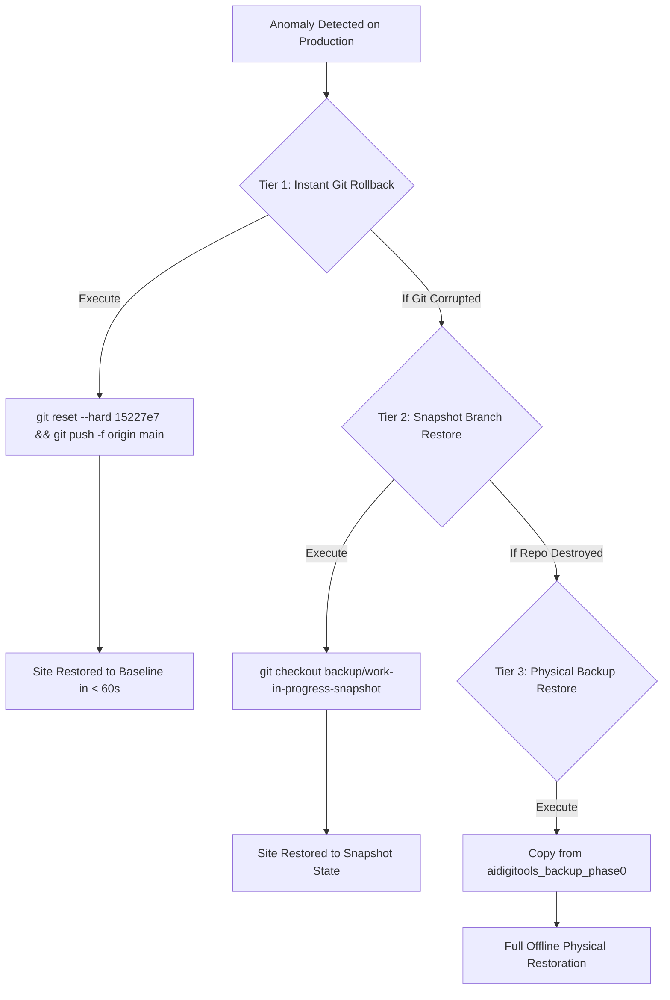

# AI DigiTools — Deployment, Verification & Rollback Plan

**Document Version:** 1.0.0 (October 2026)  
**Governing Domain:** [aidigitools.tech](https://aidigitools.tech/)  
**Target Hosting:** GitHub Pages Edge CDN (Custom Apex Domain)  
**Working Branch:** `rebuild/ai-digitools-foundation`  
**Production Branch:** `main`  
**Baseline Snapshot Branch:** `backup/work-in-progress-snapshot` (`fd1e4b8`)  
**Physical Backup Location:** `C:\Users\Dell\Desktop\aidigitools_backup_phase0`  

---

## 1. Deployment Overview & Philosophy

The AI DigiTools website rebuild is a non-destructive, additive upgrade of the static marketplace platform. All development has been conducted on the dedicated branch `rebuild/ai-digitools-foundation`, leaving the original `main` branch intact at commit `15227e7`.

Before merging into `main` and triggering GitHub Pages production deployment:
1. All 140+ automated unit tests across 11 test suites must pass (100% pass rate).
2. All 53 HTML files must pass link-graph verification (0 broken links, 0 broken anchors across 1,774 links).
3. All image dimensions, schema markups, and canonical tags must be verified.
4. A multi-tiered rollback protocol must be active.

---

## 2. Pre-Deployment Verification Checklist

```
+----+---------------------------------------------------+---------+
| #  | Verification Task                                 | Status  |
+----+---------------------------------------------------+---------+
| 1  | 140+ Unit Tests passing (python -m unittest)      | [PASS]  |
| 2  | Link Graph Validation (0 broken across 1,774)     | [PASS]  |
| 3  | 53 Published Routes tested (HTTP 200 OK)          | [PASS]  |
| 4  | Canonical self-referencing check (53/53)          | [PASS]  |
| 5  | Structured Data syntax validation (178/178 blocks)| [PASS]  |
| 6  | Robots.txt & sitemap.xml synchronization          | [PASS]  |
| 7  | IndexNow key & BingSiteAuth.xml presence          | [PASS]  |
| 8  | Zero exposed secrets or wholesale cost leaks      | [PASS]  |
| 9  | Mobile & Desktop responsive layout check          | [PASS]  |
| 10 | Git working tree clean on rebuild branch          | [PASS]  |
+----+---------------------------------------------------+---------+
```

---

## 3. Deployment Procedure (Step-by-Step)

When authorized to merge into `main`:

### Step 1: Final Pre-Merge Fast-Forward Check
```bash
git checkout rebuild/ai-digitools-foundation
git status
python -m unittest discover tests
```

### Step 2: Merge into `main` via Non-Fast-Forward Merge
```bash
git checkout main
git merge --no-ff rebuild/ai-digitools-foundation -m "release: merge AI DigiTools complete rebuild (Phases 0-15)"
```

### Step 3: Push to GitHub Remote
```bash
git push origin main
```
*Note: GitHub Pages edge CDN automatically detects commits on `main` and deploys the updated static files within 30–60 seconds.*

### Step 4: Post-Deployment Edge Verification
1. Inspect `https://aidigitools.tech/` over HTTPS to confirm live header and layout rendering.
2. Inspect `https://aidigitools.tech/sitemap.xml` to verify 52 canonical URLs are discoverable.
3. Inspect `https://aidigitools.tech/robots.txt` to verify crawler directives.
4. Trigger IndexNow URL submission script:
   ```bash
   python scripts/submit_indexnow.py
   ```

---

## 4. Rollback Plan & Recovery Protocol

If any unforeseen production anomaly occurs post-deployment, three distinct recovery tiers are immediately available:



### Tier 1: Instant Git Hard Reset (Recovery Time: < 60 seconds)
```bash
git checkout main
git reset --hard 15227e7
git push --force origin main
```
*This instantaneously restores the `main` branch to the exact baseline state before any rebuild modifications.*

### Tier 2: Snapshot Branch Restoration (Recovery Time: < 2 minutes)
```bash
git checkout -B main backup/work-in-progress-snapshot
git push --force origin main
```
*Restores the complete snapshot captured in Phase 0 commit `fd1e4b8`.*

### Tier 3: Physical Directory Restoration (Recovery Time: < 5 minutes)
*Directory Location:* `C:\Users\Dell\Desktop\aidigitools_backup_phase0`  
Contains all 389 original repository files and directories. Copying this directory back to the working root completely reconstitutes the repository from offline cold storage.

---

## 5. Ongoing Monitoring & Incident Response

1. **Google Search Console:** Monitor URL Inspection and Coverage reports for 404/500 status codes.
2. **Bing Webmaster Tools:** Review Site Scan diagnostics.
3. **Uptime & SSL Monitoring:** Automated HTTPS certificate renewal verification via GitHub Pages Let's Encrypt integration.
