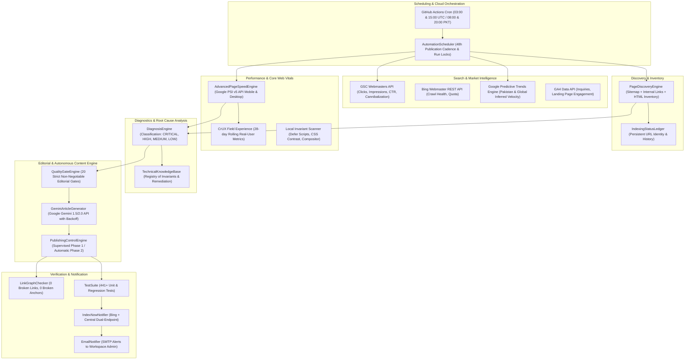

# AI DigiTools — Technical Knowledge Base & Engineering Standards
## Authoritative Documentation, Performance Invariants, and Diagnostics Registry

> **Official Authority Hierarchy**:
> 1. [Google PageSpeed Insights API (v5)](https://developers.google.com/speed/docs/insights/v5/about) & [REST Reference](https://developers.google.com/speed/docs/insights/rest)
> 2. [Google Search Central Official Documentation](https://developers.google.com/search/docs) & [Creating Helpful, Reliable Content](https://developers.google.com/search/docs/fundamentals/creating-helpful-content)
> 3. [Google Core Web Vitals Official Guide](https://developers.google.com/search/docs/appearance/core-web-vitals) & [web.dev Core Web Vitals](https://web.dev/explore/fast)
> 4. [Chrome Lighthouse Official Documentation](https://developer.chrome.com/docs/lighthouse/)
> 5. [W3C Web Content Accessibility Guidelines (WCAG 2.1 / 2.2)](https://www.w3.org/WAI/standards-guidelines/wcag/)
> 6. [MDN Web HTTP Security Headers](https://developer.mozilla.org/en-US/docs/Web/HTTP/Headers)
> 7. [Google Search Essentials & Spam Policies](https://developers.google.com/search/docs/essentials)

---

## 1. System Architecture Map

---

## 2. Core Modules, Responsibilities & Failure Handling

| Module | Core Responsibility | Inputs | Outputs | Failure Handling |
| :--- | :--- | :--- | :--- | :--- |
| `automation_scheduler.py` | 48h cadence lock, budget tracker, run locks, cron execution | Config, Environment, Run History | `scheduler_run_report.json`, run lock | Stale locks expire after 120m; skips with explicit reason if budget/cadence locked |
| `page_discovery_engine.py` | Dynamic discovery of all site pages from sitemap, routes, links | Filesystem, `sitemap.xml`, live HTTP | `discovered_urls_registry.json`, orphan alerts | Resilient fallback to local HTML walk if network is unavailable |
| `core_web_vitals_engine.py` | Google PageSpeed Insights v5 audits (Mobile + Desktop) & local checks | Live URLs, HTML files, CSS files | Lab scores, CWV metrics, failure diagnostics | Exponential backoff on HTTP 429; local invariant audit if unconfigured |
| `search_intelligence.py` | GSC, Bing, GA4, and Google Trends aggregation | API keys, Seed queries | `search_intelligence_latest.json` | Truthfully reports `UNCONFIGURED` when credentials absent; never simulates success |
| `diagnosis_engine.py` | Root-cause analysis, issue classification, remediation planning | PSI audit data, local invariants | Prioritized issue queue with confidence scores | Proposes non-destructive solutions; rejects risky automated resets |
| `quality_gates.py` | 20 mandatory invariants (single H1, quick answer, table, reseller notice) | HTML draft, metadata | Pass/Fail verdict with specific failed gate IDs | Rejects draft publication; saves to `human_review_queue.json` if ambiguous |
| `indexing_notifier.py` | Live HTTP 200 verification, sitemap sync, dual IndexNow dispatch | Production URLs, `sitemap.xml` | `indexing_status_ledger.json` | Never calls Google Indexing API for editorial content; preserves IndexNow retry queue |
| `deployment_verifier.py` | Live HTTPS deployment and canonical verification | Live URL or local file | Verification verdict (True/False) | Times out cleanly after 10s; distinguishes local valid from live verified |

---

## 3. Structured Technical Knowledge Registry

### Entry 01: Render-Blocking Resources (JavaScript)
* **Issue Type**: Performance / Core Web Vitals (LCP & FCP)
* **Technical Explanation**: Synchronous ``) or move to bottom of `<body>`.
* **Verification Procedure**: Re-run Lighthouse audit; confirm script is removed from `render-blocking-resources` table and FCP/LCP improves.
* **Known Limitations**: Inline scripts without `type="module"` cannot use `defer`. Scripts that immediately manipulate DOM during page load must remain inline or be refactored.
* **Last Reviewed Date**: 2026-11-05

### Entry 02: Color Contrast Inadequacy (WCAG AA Compliance)
* **Issue Type**: Accessibility / Usability
* **Technical Explanation**: Foreground text and background color must have sufficient visual contrast so users with low vision can perceive the content. WCAG 2.1 Level AA requires a contrast ratio of at least **4.5:1** for normal text and **3.0:1** for large text (18pt or 14pt bold).
* **Official Documentation**: [W3C WCAG 2.1 Understanding Success Criterion 1.4.3: Contrast (Minimum)](https://www.w3.org/WAI/WCAG21/Understanding/contrast-minimum.html) & [Google Lighthouse: Color Contrast](https://developer.chrome.com/docs/lighthouse/accessibility/color-contrast/)
* **Detection Procedure**: Compute relative luminance of foreground (`#FFFFFF`) against background. E.g., `#10B981` yields 2.2:1 (FAIL). `#047857` yields 5.1:1 (PASS).
* **Recommended Remediation**: Adjust background or text color token to achieve >= 4.5:1. For WhatsApp emerald buttons, use `#047857` (normal) and `#065F46` (hover).
* **Verification Procedure**: Audit element via Lighthouse Accessibility category; confirm 0 contrast violations.
* **Known Limitations**: Gradients, background images, and semi-transparent overlays require worst-case contrast calculations.
* **Last Reviewed Date**: 2026-11-05

### Entry 03: Non-Composited Animations
* **Issue Type**: Performance / Main-Thread Jank & INP
* **Technical Explanation**: CSS animations that animate non-compositor properties (such as `box-shadow`, `stroke-dashoffset`, `filter`, `width`, `height`, `top`, `left`) trigger CPU paint and layout recalculations on every frame, causing main-thread contention. The GPU compositor can only composite `transform` and `opacity` off the main thread.
* **Official Documentation**: [Google Chrome DevTools: Avoid Non-Composited Animations](https://developer.chrome.com/docs/performance/insights/non-composited-animations/) & [web.dev: Stick to Compositor-Only and Manage Layer Count](https://web.dev/articles/stick-to-compositor-only-properties-and-manage-layer-count)
* **Detection Procedure**: Check CSS `@keyframes` rules for non-composited properties (`box-shadow`, `filter`, `stroke-dashoffset`). Flagged in Lighthouse under `non-composited-animations`.
* **Recommended Remediation**: Refactor animations to use `transform: scale()`, `transform: translate()`, and `opacity`. Use pseudo-elements for pulsing rings rather than animating `box-shadow`.
* **Verification Procedure**: Lighthouse audit returns pass for `non-composited-animations`.
* **Known Limitations**: SVG stroke animations (e.g. animated dashed lines) cannot be fully GPU-composited in CSS without SVG SMIL or canvas; wrap in `@media (prefers-reduced-motion: no-preference)` and reduce frame rates.
* **Last Reviewed Date**: 2026-11-05

### Entry 04: HTTP Security Headers in Static Hosting Environments
* **Issue Type**: Security / Infrastructure
* **Technical Explanation**: Modern web applications must declare HTTP security headers (HSTS, CSP, X-Content-Type-Options, Referrer-Policy, Permissions-Policy) to mitigate cross-site scripting (XSS), clickjacking, MIME-sniffing, and SSL-stripping attacks.
* **Official Documentation**: [MDN Web Docs: Security Headers](https://developer.mozilla.org/en-US/docs/Web/HTTP/Headers) & [Google Search Central: Secure your site with HTTPS](https://developers.google.com/search/docs/crawling-indexing/https)
* **Detection Procedure**: Probe live domain headers via HTTP GET; check for `Strict-Transport-Security`, `X-Content-Type-Options`, `X-Frame-Options`, `Content-Security-Policy`.
* **Recommended Remediation**:
  1. For pure GitHub Pages: Include `<meta http-equiv="...">` tags in HTML `<head>` where supported (`Content-Security-Policy`, `X-UA-Compatible`, `<meta name="referrer" content="...">`).
  2. For Cloudflare proxy (recommended production setup): Configure Cloudflare Transform Rules to inject origin-level HTTP response headers (`Strict-Transport-Security: max-age=31536000; includeSubDomains; preload`, `X-Content-Type-Options: nosniff`, `X-Frame-Options: SAMEORIGIN`, `Permissions-Policy: camera=(), microphone=(), geolocation=()`).
* **Verification Procedure**: Curl live HTTPS endpoint; assert presence of expected headers.
* **Known Limitations**: GitHub Pages static servers do not support `.htaccess` or custom origin server configs. Full HTTP header enforcement requires an edge reverse proxy (e.g., Cloudflare, Fastly, or Netlify).
* **Last Reviewed Date**: 2026-11-05

### Entry 05: Core Web Vitals Distinction: Lab (Lighthouse) vs Field (CrUX)
* **Issue Type**: Search & User Experience Monitoring
* **Technical Explanation**:
  - **Lighthouse (Lab)**: Simulated synthetic environment (controlled device, throttled 4G network, single page run). Excellent for catching regressions during development, but does not represent actual user distributions.
  - **CrUX (Field)**: Real-world 28-day rolling aggregated telemetry collected from logged-in Chrome users on diverse devices and networks. Google uses **CrUX field data** (not Lighthouse scores) for Core Web Vitals ranking evaluation.
* **Official Documentation**: [Google Search Central: Understanding Core Web Vitals and Search Results](https://developers.google.com/search/docs/appearance/core-web-vitals) & [web.dev: How CrUX data is collected](https://developer.chrome.com/docs/crux/)
* **Detection Procedure**: In PSI API response, distinguish `lighthouseResult` (Lab) from `loadingExperience` (URL Field) and `originLoadingExperience` (Domain Field).
* **Recommended Remediation**: Never describe a single Lighthouse run as proof of real user experience. If URL-level CrUX has insufficient data, report Origin-level CrUX if available, and state sample limitations clearly.
* **Verification Procedure**: Check CrUX API status flag; record both synthetic and real-world metrics side by side.
* **Known Limitations**: Sites with under ~1,000 monthly unique visitors in the Chrome User Experience dataset will report `INSUFFICIENT_DATA` for URL-level CrUX metrics.
* **Last Reviewed Date**: 2026-11-05

---

## 4. Engineering Standards & Release Verification Checklist

Every pull request or release must satisfy all 8 verification gates:
1. **Zero Failing Tests**: `python -m unittest discover -s tests -v` (100% pass).
2. **Zero Broken Links & Anchors**: `python scripts/link_graph_checker.py --strict` (0 broken links, 0 broken anchors).
3. **Strict Typographic & SEO Character Limits**: `python scripts/check_seo_metrics.py` (Title 30–65, Description 70–165, Quick Answer 35–70 words).
4. **WCAG AA Color Contrast**: All primary and secondary CTAs must achieve >= 4.5:1 contrast against their backgrounds.
5. **No Render-Blocking First-Party Scripts**: First-party scripts must specify `defer`.
6. **Valid Structured Data**: JSON-LD scripts must parse cleanly without syntax errors and match visible DOM content.
7. **Strict Independent Reseller Notice**: Must feature independent reseller disclaimer; zero claim of direct provider partnership.
8. **Safe WhatsApp Route**: Must retain WhatsApp number `03326861112` / `+92 332 6861112` and transparent PKR pricing.
